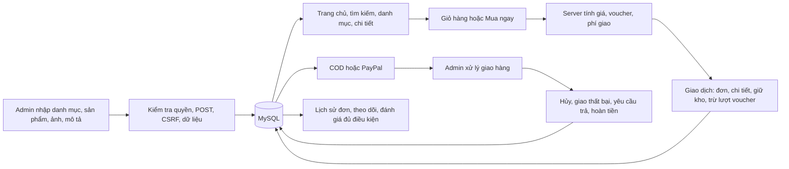

# Rà soát và hoàn thiện toàn bộ luồng dữ liệu

Ngày thực hiện: **21/10/2026**, giờ Việt Nam. Thư mục: `D:/phpweb-main`.

**Đã sửa mã nguồn, nâng cấp cấu trúc CSDL local và kiểm tra luồng Admin → CSDL → khách hàng → đơn/thanh toán/kho → Admin.** Kết quả cuối: **158 kiểm tra luồng + 42 kiểm tra PayPal ngoại tuyến đạt, 0 lỗi**. PHP lint: **61 tệp mã tự viết đạt**. Kết quả kiểm tra là bằng chứng cho các tình huống đã thực hiện, không phải cam kết không bao giờ phát sinh lỗi.

Các dữ liệu cũ thiếu chứng từ được liệt kê riêng ở mục 8. Không suy đoán thông số kỹ thuật, giá lịch sử, điểm cũ hoặc ngày giao để lấp dữ liệu.

## 1. Bản đồ luồng và nơi lưu

| Nghiệp vụ | Điểm nhận | Bảng/CSDL | Nơi phải xuất hiện |
| --- | --- | --- | --- |
| Thêm/sửa danh mục | Form trong quản lý sản phẩm | `danhmuc` | Bộ lọc trang chủ, lựa chọn danh mục trong form, danh sách Admin |
| Thêm/sửa sản phẩm | `themsanpham`, `suasanpham` | `sanpham` | Trang chủ, tìm kiếm, danh mục, chi tiết, giỏ và giá tại checkout |
| Ảnh chính/album | Form multipart, bộ xử lý upload | `sanpham.hinh`, `sanpham.anh_phu`; file trong `view/image/uploads` | Trang chi tiết, thẻ sản phẩm, ảnh xem trước trong Admin |
| Đặt hàng | `thanhtoan` | `donhang`, `chitietdonhang`, `lichsu_kho`, `lichsu_donhang`, `voucher` | Lịch sử/theo dõi khách và danh sách/chi tiết đơn Admin |
| PayPal | Các route `paypal_*` | `thanhtoan_paypal` | Trang thanh toán, lịch sử khách và đối soát Admin |
| Yêu cầu trả | `yeucautra` | `trahang`, `lichsu_donhang` | Khách thấy yêu cầu; Admin xử lý trong đơn hàng |
| Hoàn tiền COD | `hoancod` | `trahang` và lịch sử đơn | Trạng thái/chứng từ hoàn tiền ở đơn của khách và Admin |
| Nhận xét | `themdanhgia` | `danhgia` | Trang chi tiết và quản lý đánh giá |
| Khiếu nại | `khieunai` | `email`, loại `khieunai` | Hộp thư khách, mục khiếu nại trong quản lý đơn Admin |

## 2. Admin thêm/sửa sản phẩm → CSDL → trang khách

Đã sửa action của tất cả form Admin và action gán bằng JavaScript để giữ `khu=admin`. Trước đây form có thể đi sang controller khách nên thao tác không lưu đúng nơi. Kiểm tra gồm POST qua HTTP, truy vấn lại bản ghi và đọc HTML trang khách; không chỉ kiểm tra thông báo thành công.

Các trường lưu trong CSDL: mã, tên, danh mục, giá, tổng lượng nhập, tồn khả dụng, ảnh chính, album, mô tả, thương hiệu, thông số kỹ thuật, bảo hành, hạn sử dụng. Mô tả và thông số giữ xuống dòng, được escape khi hiển thị. Đã bỏ mảng sản phẩm mẫu theo ID, thông số/giá dung lượng cố định, nhận xét mẫu và mức tiết kiệm viết cứng.

Ảnh upload: JPG/PNG/WebP, kiểm tra file được upload thật, MIME, kích thước ảnh và giới hạn 5 MB/ảnh; tối đa 6 ảnh bổ sung. Tên được sinh ngẫu nhiên. Không dùng tên do trình duyệt gửi làm tên lưu. Sửa mà không tải ảnh mới sẽ giữ ảnh cũ; nếu lưu DB thất bại, ảnh vừa tải được dọn. Ảnh cũ không tự xóa khi thay vì có thể còn được hóa đơn hoặc bản ghi khác tham chiếu.

Sau khi lưu thành công, request kế tiếp của trang chủ/chi tiết đọc dữ liệu mới. Trang động gửi `Cache-Control: no-store`. Đây là cập nhật khi tải trang hoặc điều hướng; chưa có WebSocket tự đẩy thay đổi vào tab khách đang mở sẵn.

Sản phẩm liên quan lấy tối đa 4 sản phẩm cùng danh mục, loại chính sản phẩm hiện tại, ưu tiên còn hàng. Không dùng ID mẫu. Banner nổi bật lấy sản phẩm từ CSDL; phản hồi chatbot dự phòng tìm theo dữ liệu sản phẩm và giá khuyến mãi đang có.

## 3. Giỏ hàng và Mua ngay

- Thẻ sản phẩm có **Mua ngay** và **Thêm vào giỏ hàng**. Theo yêu cầu, nút thứ hai trên danh sách mở trang chi tiết để xem thông tin/chọn số lượng.
- Tại trang chi tiết, **Thêm vào giỏ hàng** gửi một POST duy nhất và trở lại chi tiết kèm thông báo/xem giỏ. Không còn fetch ngầm cộng thêm một sản phẩm.
- **Mua ngay** dùng danh sách thanh toán riêng trong session, đi trực tiếp tới checkout sau khi đăng nhập, giữ nguyên giỏ đang có.
- Thanh toán từ giỏ dùng toàn bộ giỏ. Mua ngay chỉ dùng sản phẩm/số lượng vừa chọn; đã kiểm tra cả trường hợp giỏ cũ đang có hàng khác.
- Giỏ không giữ tồn kho. Tồn được kiểm tra lại khi đặt đơn. Giá/tên/ảnh do trình duyệt gửi không được dùng để tính hóa đơn.
- Thêm/sửa/xóa giỏ, nhận xét, hủy đơn, trả hàng, khiếu nại, đăng nhập/đăng ký/đăng xuất có cổng POST/CSRF tương ứng. Request GET làm thay đổi dữ liệu bị chặn.

## 4. Đặt đơn, thanh toán và tồn kho

Trong một transaction, khóa khách hàng và các sản phẩm theo thứ tự ID; đọc giá/khuyến mãi hiện hành; kiểm tra số lượng; khóa voucher; ghi đơn và chi tiết; trừ kho và lượt voucher; ghi lịch sử. Nếu một bước lỗi, rollback cả đơn, chi tiết, kho, voucher và lịch sử.

Công thức: `tạm tính = tổng(đơn giá sau khuyến mãi × số lượng)`; `tổng = max(0, tạm tính − voucher) + phí giao`. Phí mặc định 30.000đ; Gold/Diamond miễn ship. Mỗi đơn lưu tạm tính, số tiền giảm và ID voucher; chi tiết lưu giá, tên/mã/ảnh tại thời điểm đặt để việc Admin đổi sản phẩm sau đó không sửa hóa đơn cũ.

COD dùng khóa đặt đơn để chống gửi lại form cũ; gửi lại cùng khóa trả về cùng đơn và không lấy hàng ở giỏ mới. Thành công chỉ được chuyển sau Đã giao; bước này là xác nhận đơn hoàn tất/thu tiền, cộng điểm một lần.

PayPal tiếp tục xác minh merchant, tiền tệ, số tiền, capture và trạng thái từ phía máy chủ. Chỉ trạng thái đã nhận tiền mới cho phép giao. Timeout, pending và kết quả không rõ chưa được coi là đã thanh toán. Chống lặp capture bằng khóa/idempotency và khóa xử lý.

Đơn PayPal chưa thanh toán có hạn 30 phút. Các trang catalog, checkout, lịch sử và danh sách sản phẩm/đơn Admin giải phóng đơn hết hạn theo lô khi được truy cập. Có thêm CLI `support/scripts/expire_paypal.php` nếu hosting cần gọi bằng cron. Không tự tạo lịch cron trong lần sửa này; lúc không có request hay cron, thời điểm hết hạn tự nó chưa chạy mã PHP. Khoản đang xử lý/pending hoặc cần đối soát không bị tự hoàn kho.

Kho khả dụng và hàng lỗi được tách. Nhập thêm tăng tổng nhập và tồn trong cùng transaction. Ô kiểm kê chỉ giảm tồn khả dụng; tăng kho dùng ô Nhập thêm. Form sửa mang tồn cũ để phát hiện giao dịch mua phát sinh lúc Admin đang mở form, tránh ghi đè tồn mới. `lichsu_kho` lưu thay đổi, tồn sau, đơn liên quan và lý do.

## 5. Khi nào được hủy, trả và hoàn tiền

| Tình trạng | Khách | Admin | Kho / tiền |
| --- | --- | --- | --- |
| Chờ xác nhận | Hủy được | Hủy hoặc xác nhận | Hủy hoàn kho/lượt voucher một lần |
| Xác nhận đơn hàng | Hủy được trước giao | Hủy hoặc chuyển Đang giao | Như trên |
| Đang giao | Không hủy trực tiếp | Đã giao hoặc xử lý Bom/Trả sau khi nhận lại hàng | Không giải phóng hàng đang ở đơn vị vận chuyển chỉ bằng thao tác hủy |
| Đã giao / Thành công | Gửi yêu cầu trả trong 7 ngày từ ngày giao | Xem lý do, từ chối có phản hồi, hoặc nhận lại và xử lý | Gửi yêu cầu chưa đổi kho/điểm/tiền |
| Đã hủy / Bom / Trả | Không lặp trạng thái | Không lặp trạng thái | Không hoàn kho/voucher/điểm lần hai |

Quy trình trả hiện hỗ trợ **toàn bộ đơn**, mỗi đơn một yêu cầu. Admin phải xác nhận đã nhận và kiểm tra hàng. Chọn bán lại thì cộng kho khả dụng; bỏ chọn thì tăng hàng lỗi/cách ly, không đưa lại lên tồn bán. Khi chấp thuận trả đơn Thành công, thu hồi đúng điểm đã cộng bởi đơn, xét lại hạng và loại đơn khỏi doanh thu.

Hoàn toàn bộ tổng thanh toán của đơn trả. COD có `Chờ hoàn tiền` riêng sau khi nhận hàng; Admin phải nhập chứng từ/mã tham chiếu sau khi thực hiện trả tiền, rồi mới xác nhận `Đã hoàn tiền`. Nút xác nhận COD ghi chứng từ, **không phải API chuyển tiền ngân hàng**.

PayPal đã thu tiền: cửa hàng hoàn tiền trong PayPal rồi bấm đối soát; khi đã xác nhận hoàn toàn bộ mới kết thúc hủy/trả/hoàn kho. Chưa có nút tự phát lệnh refund từ website. Khoản hoàn một phần/reversed vẫn cần đối soát. Thử nghiệm ngoại tuyến đã kiểm tra không hoàn kho trước refund, chỉ hoàn một lần sau đối soát.

Admin hủy vì lý do cửa hàng không tăng số lần hủy của khách. Trả hàng được chấp nhận không tự coi là vi phạm của khách. Lý do và actor được lưu trong lịch sử, khách theo dõi được kết quả trên đơn.

## 6. Voucher, thành viên và đánh giá

Voucher áp dụng **đồng thời** theo ngày bắt đầu/kết thúc (bao gồm hai đầu ngày theo giờ Việt Nam), lượt còn lại, giá trị đơn tối thiểu và hạng tối thiểu. Gold áp dụng cho Gold/Diamond; Diamond chỉ Diamond. Một đơn một voucher. Khuyến mãi sản phẩm/danh mục lấy mức phần trăm tốt nhất đang chạy; voucher tính trên tiền hàng sau khuyến mãi. Trang checkout xem được mã đang chạy/điều kiện và áp dụng để xem tổng dự kiến; server tính lại khi đặt đơn.

Lượt voucher giảm khi giữ đơn và hoàn lại khi hủy/bom/trả đúng một lần bằng ID voucher. Hoàn lượt không kéo dài ngày hết hạn. Voucher đã dùng cho đơn không bị xóa để tránh mất liên kết đối soát. Hạng: Silver dưới 500 điểm, Gold từ 500, Diamond từ 2.000; mỗi 1.000đ tổng đơn Thành công được 1 điểm, làm tròn xuống.

Đánh giá được kiểm tra ở model/backend: tài khoản hoạt động, đã có đơn chứa đúng sản phẩm ở Đã giao/Thành công, mỗi khách/sản phẩm một lần. Không nhận họ tên tự khai để gắn nhãn đã mua. View hiển thị nhận xét từ CSDL; nội dung ẩn hoặc không còn bằng chứng nhận hàng không xuất hiện công khai. Không còn sao trên thẻ và phần đầu sản phẩm; mức độ hài lòng của form dùng nhãn chữ.

## 7. Giao diện, quyền và bảo vệ dữ liệu

Đăng nhập chỉ có một giao diện chung; tài khoản nhân viên/quản trị tự điều hướng vào Admin. Bỏ nút đăng nhập Admin công khai và màn hình đăng nhập Admin riêng. Giữ phân quyền SuperAdmin/Quản lý/Nhân viên sẵn có ở server, không chỉ ẩn nút.

Bỏ A1/A2, chữ giải thích CSDL/Lab, sao sản phẩm và các cam kết quảng cáo/chứng nhận/liên kết mẫu không có chức năng. Giao diện mặc định về nền trung tính; Admin vẫn chọn lại được theme. Menu Admin gọn, có cơ chế thu gọn trên màn hình nhỏ; form ảnh, mô tả, thương hiệu, bảo hành, thông số và nút xem sản phẩm được đặt tại quản lý sản phẩm.

Escape tên tài khoản, nội dung và thuộc tính ảnh; phản hồi chat hiển thị text thay vì chèn HTML. Loại hash mật khẩu/secret khỏi JSON theo cơ chế dùng chung. Bỏ việc nhân viên đổi mật khẩu làm cập nhật nhầm tài khoản khách admin. Bỏ checkbox ghi nhớ đăng nhập chưa có backend. Gửi thư phân biệt lưu hộp thư với SMTP gửi thật. Thông báo lưu giao diện/ẩn đánh giá/xóa voucher/khóa khách được đối chiếu kết quả.

CSDL có CHECK cho giá/tồn/số lượng/phần trăm/ngày; unique cho tên danh mục và khách/sản phẩm đánh giá. Migration kiểm tra dữ liệu cũ trước khi thêm ràng buộc; nếu gặp vi phạm sẽ ghi lại thay vì sửa số liệu lịch sử. Các truy vấn tổng hợp sản phẩm trên trang chủ được gom theo danh sách; SQL xem bảng được chuyển khỏi controller sang model.

## 8. Đối chiếu dữ liệu local hiện có

Kết quả đọc lúc **2026-10-21T21:41:43+07:00**. Đây là dữ liệu đang có sau migration, không phải dữ liệu fixture của bộ test.

| Nội dung | Số lượng | ID |
| --- | ---: | --- |
| Tồn kho hoặc giá không hợp lệ | 0 | — |
| Sản phẩm thiếu mô tả | 0 | — |
| Sản phẩm chưa nhập thương hiệu/thông số/bảo hành | 5 | 1, 2, 3, 4, 5 |
| Đơn mới lệch tổng tiền | 0 | — |
| Đơn cũ thiếu bản chụp giảm giá (cần đối chiếu thủ công) | 4 | 1, 2, 3, 4 |
| Chi tiết đơn cũ thiếu tên tại thời điểm mua | 4 | 1, 2, 3, 4 |
| Đơn giao cũ thiếu ngày giao | 1 | 1 |
| Đánh giá chưa xác minh nhận hàng (được ẩn trên trang khách) | 2 | 2, 3 |
| Đánh giá trùng khách/sản phẩm | 0 | — |
| Voucher sai ngày, số lượng hoặc mức giảm | 0 | — |
| Hạng thành viên không khớp điểm | 1 | 2 |
| Điểm khác tổng đơn thành công (cần kiểm tra số dư cũ) | 3 | 1, 2, 3 |
| Đơn PayPal chờ thanh toán đã hết hạn | 0 | — |
| Đơn kết thúc nhưng PayPal chưa hoàn tiền/đối soát | 0 | — |
| Đơn đang xử lý sau khi PayPal đã hoàn tiền | 0 | — |
| Tồn kho lệch bản ghi biến động mới nhất | 0 | — |
| Sản phẩm cũ chưa có mốc kiểm kê (chưa đủ chứng cứ đối soát kho) | 5 | 1, 2, 3, 4, 5 |

Các điểm còn cần thông tin thực:

- 5 sản phẩm cũ cần Admin nhập thương hiệu/thông số/bảo hành; mô tả sẵn có vẫn được giữ và hiển thị. Không gắn thông số của điện thoại khác theo ID.
- 4 đơn cũ thiếu tạm tính/giảm giá và tên lúc mua. Giá hiện tại, mã voucher hiện tại không đủ chứng minh tên/giảm giá lịch sử; không tự ghi đè hóa đơn.
- Đơn #1 thiếu ngày giao nên không tự suy ra hạn trả. Cần chứng từ giao trước khi xử lý ngoại lệ của đơn cũ.
- Đánh giá #2, #3 chưa có bằng chứng nhận hàng phù hợp; được giữ trong DB để Admin rà, ẩn trên trang khách.
- Khách #2 có hạng chưa khớp điểm; điểm khách #1/#2/#3 khác tổng đơn Thành công. Có thể do số dư/mẫu cũ nên chưa tự sửa điểm hoặc hạng. Cần kiểm tra chính sách số dư đầu kỳ trước khi chỉnh dữ liệu này; giao dịch mới vẫn cộng/thu hồi điểm theo đơn.
- 5 sản phẩm cũ thiếu mốc kho. Muốn kết luận tồn thực tế chính xác phải kiểm kê và đối chiếu đơn cũ, không chỉ nhìn hiệu `tổng nhập − tồn` rồi gọi đó là số đã bán. Số Đã bán hiện chỉ tính đơn Thành công.

Admin có **Đối chiếu dữ liệu** và **Dữ liệu CSDL** để đọc lại các mục này; có CLI `support/scripts/audit_flow.php`. Không thấy tồn/giá âm, voucher sai điều kiện hoặc xung đột PayPal trong lần đọc này; kiểm tra kho mới nhất không thể chứng minh lịch sử trước khi có sổ kho.

## 9. Bằng chứng kiểm tra

| Nhóm | Kết quả | Phạm vi |
| --- | --- | --- |
| PHP lint | 61/61 đạt | Điểm vào, controller/model/view, script, test và PayPal tự viết |
| Luồng Model + HTTP + DB | 158 PASS, 0 FAIL | CRUD/danh mục; upload; giá; giỏ; checkout; quyền; CSRF; cạnh tranh; rollback; hủy/trả; điểm; hoàn COD; dữ liệu HTML |
| PayPal ngoại tuyến | 42 PASS, 0 FAIL | Sai merchant/tiền tệ/tiền; timeout; pending; idempotency; đối soát; hết hạn; hủy; trả sau refund |
| Bảo toàn dữ liệu ứng dụng khi test | Đạt | CSDL tạm ngẫu nhiên; so cả số bản ghi và SHA-256 của toàn bộ giá trị DB ứng dụng trước/sau bộ test luồng |
| Giao diện | Đã xem | Trang khách local trên màn hình nhỏ; ảnh fixture form Admin trên desktop và mobile; thử nút Sửa nạp dữ liệu |

Kết quả máy: [ketqua_test.json](support/tests/ketqua_test.json), [ketqua_paypal.json](support/tests/ketqua_paypal.json), [doi_chieu_du_lieu.json](support/tests/doi_chieu_du_lieu.json). Bộ test bổ sung: [flow_scenarios.php](support/tests/flow_scenarios.php). Ảnh kiểm tra: [Admin desktop](support/tests/previews/admin-desktop.jpg).

Đã chạy migration additive vào CSDL local, giữ dữ liệu nghiệp vụ. Bản sao mã trước sửa được lưu tại `C:/Users/jaysm/AppData/Local/Temp/phpweb-before-flow-20261021-210942.zip`. Thư mục hiện không phải Git repository nên không có commit/diff Git. Các ZIP phát hành cũ trong thư mục gốc không được coi là bản mã đã cập nhật và chưa được đóng gói lại.

## 10. Giới hạn xác minh và vận hành

Trong lượt kiểm tra local ban đầu chưa thực hiện thu/hoàn tiền thật, đăng nhập Google thật, gửi SMTP thật hay triển khai hosting. Lần triển khai hosting tiếp theo được ghi ở phần cập nhật bên dưới. Các kết quả PayPal là test bằng bộ mô phỏng ngoại tuyến; cấu hình dịch vụ cần được kiểm tra ở môi trường nhận tiền trước khi dùng thật.

Chưa có trả từng phần đơn, quy trình bảo hành riêng, hoàn tiền ngân hàng tự động, push realtime vào tab đang mở hoặc kiểm thử tải lớn. Một số danh sách Admin vẫn chưa phân trang toàn bộ. Đây là giới hạn phạm vi đã ghi rõ, không nên diễn giải kiểm tra Model thành kiểm chứng tất cả dịch vụ/bộ trình duyệt ngoài thực tế.

Báo cáo đối chiếu sáu bài tại [BAO_CAO_DOI_CHIEU_6_BAI.md](BAO_CAO_DOI_CHIEU_6_BAI.md) đã có phần cập nhật sau sửa; phần khảo sát slide cũ được giữ làm mốc lịch sử.

## Cập nhật catalog và triển khai hosting ngày 21/10/2026

Đã tải và xác minh 38.127 tệp nguồn từ hosting, giữ bản gốc trong `D:/phpweb-hosting-sync/20261021/hosting-original-all.zip`. CSDL có hai bản sao riêng trước triển khai. Đã ghép mã, chạy lại 158 kiểm tra luồng và 42 kiểm tra PayPal ngoại tuyến, lint 51 tệp PHP ứng dụng trong bản ghép.

Đã triển khai 54 tệp đã đối chiếu. Không ghi đè cấu hình database/Google/PayPal/theme hoặc vendor. Đã kiểm tra lại tệp trên hosting; mã PHP được so SHA-256, ảnh được kiểm tra dữ liệu giải mã khi hosting tái mã hóa. Công cụ sao lưu tạm đã gỡ.

Catalog hiện có 12 sản phẩm hoạt động trong 4 danh mục, 4 voucher mới. 5 sản phẩm cũ chỉ ngừng bán để giữ liên kết với 9 đơn/10 chi tiết đơn cũ. Tài khoản khách/nhân viên, email và giao dịch PayPal vẫn giữ. Bộ test chạy trên CSDL tạm hoặc bản sao, không tạo đơn/thanh toán thật trên hosting.

Kiểm tra trực tiếp sau mở website: trang chủ 12 thẻ, không có ảnh lỗi; bộ lọc Nokia 2 mẫu; trang chi tiết Nokia có mô tả/thông số/bảo hành và hai nút riêng; khách chưa đăng nhập được đưa tới đăng nhập khi Mua ngay. Cấu hình Google và thư viện được bảo toàn; chưa xác thực lại một phiên Google thật hay thanh toán/hoàn tiền thật.

Chi tiết giá/tồn thử và cách tạo mã: [Hướng dẫn voucher và catalog](HUONG_DAN_VOUCHER_VA_CATALOG.md). Các ZIP phát hành cũ ở gốc dự án vẫn là bản cũ.

## Sửa lỗi 403 khi thêm/sửa sản phẩm — 22/10/2026

Đã tái hiện lỗi `403 Forbidden / openresty` trên hosting khi gửi form `multipart/form-data`, kể cả không chọn ảnh. Form chưa đến PHP nên không phải thông báo quyền hoặc CSRF của ứng dụng. Đã đổi form lưu sản phẩm sang URL-encoded; JavaScript gửi từng ảnh qua cùng phiên admin, nhận mã ảnh tạm rồi gửi dữ liệu sản phẩm. Ảnh tạm nằm trong thư mục cấm truy cập web, gắn với phiên và ID admin, hết hạn sau 15 phút. Máy chủ vẫn kiểm tra quyền, POST, CSRF, nội dung/MIME ảnh, tối đa 5 MB/ảnh và 6 ảnh album.

Đã triển khai đúng 4 tệp: `controller/product_upload.php`, `controller/admin/index.php`, `view/admin/sanpham.php`, `view/js/product-upload.js`. Đã đối chiếu SHA-256 của cả 4 tệp trên hosting và xác nhận cấu hình database/Google/PayPal/theme không đổi. Bản trước sửa, manifest và kết quả kiểm tra tại `D:/phpweb-hosting-sync/20261021/fix403/`.

Kiểm tra tự động mới nhất: **168 PASS, 0 FAIL** trên CSDL tạm; toàn bộ giá trị và số bản ghi CSDL ứng dụng local không đổi. Bao gồm thêm mới qua HTTP → CSDL → HTML khách, ảnh chính/album, ảnh đúng 5 MB, ảnh quá dung lượng/giả, mã ảnh sai/đã dùng/thuộc phiên khác, quyền và CSRF. PHP lint và JavaScript syntax check đạt.

Kiểm tra trực tiếp bằng phiên admin thật: gửi form thêm với mã đã có, cả không ảnh và có ảnh chính + 2 ảnh album, đều nhận lỗi mã trùng từ ứng dụng thay vì 403 và giữ nội dung nhập. Dùng mã trùng để không tạo sản phẩm thử trên cửa hàng. Tiếp theo đã sửa sản phẩm #6 bằng đúng ảnh gốc, nhận thông báo lưu thành công; trang khách đọc đường ảnh mới từ CSDL và tải ảnh 900 px thành công. Sau đó khôi phục đường ảnh gốc, đối chiếu toàn bộ trường sản phẩm khớp trước thử; danh sách vẫn có 12 sản phẩm. Không tạo đơn hay thanh toán thật trong lượt này. Thêm mới thành công được xác minh tự động trên CSDL tạm; chưa tạo bản ghi sản phẩm mới trên production.

## Chuyển khoản QR và sửa voucher — 22/10/2026

Đã thêm phương thức chuyển khoản QR, admin xác nhận; giữ COD, PayPal và Google. Ngân hàng/tài khoản/tên/số tiền/nội dung được chụp vào bảng `thanhtoan_qr` khi đặt đơn trong cùng transaction giữ kho và voucher. Không dùng số thẻ hoặc thông tin đăng nhập ngân hàng. Khách báo đã chuyển chỉ tạo trạng thái chờ đối soát; Admin/SuperAdmin kiểm tra tiền thực tế rồi ghi số tiền, mã giao dịch. Hệ thống lưu người/thời gian, chống trùng chứng từ, chặn giao hàng khi chưa nhận tiền, xử lý hoàn, tiền đến sau hủy và cạnh tranh hủy/nhận tiền.

Lỗi voucher được xác định ở nhánh checkout: khi `intent=voucher` nhưng phương thức là PayPal, mã cũ từ chối mọi phương thức khác COD trước khi xử lý xem tổng. Đã tách preview khỏi tạo đơn, giữ lựa chọn và dữ liệu nhập, thêm bỏ mã, điều kiện theo từng đơn và tổng chưa giảm khi mã sai. Không trừ lượt khi preview; khi lưu đơn kiểm tra lại dưới khóa DB. Mã miễn ship không tiêu lượt nếu hạng đã miễn ship. Một checkout key dùng chung ngăn gửi lại tạo đơn khác khi đổi phương thức; email và lịch sử thể hiện đúng QR thay vì COD.

Kiểm thử mới nhất **206 PASS, 0 FAIL** (Model/HTTP/DB/HTML, CSDL tạm, gồm 38 ca mới so với 168 trước đó); **43 PASS, 0 FAIL** PayPal ngoại tuyến. Đã kiểm tra PHP syntax cho các tệp thay đổi. Toàn bộ giá trị/số bản ghi DB ứng dụng local được so trước/sau bộ test. Sau đó chủ động thêm bảng QR rỗng vào local bằng SQL additive; trên hosting khởi tạo bảng qua POST admin có quyền/CSRF, không import/reset DB cũ.

Đã triển khai 20 tệp, lưu bản nguồn hosting trước sửa và kiểm chứng SHA-256 sau triển khai tại `D:/phpweb-hosting-sync/20261022-qr/manifest.json`. Giữ nguyên hash cấu hình database/Google/PayPal/theme. Không ghi đè `database/schema.sql` trên hosting vì đó là tệp schema cũ khác baseline local; migration QR dùng riêng `database/bank.sql`. Schema local cho cài mới đã bổ sung bảng QR.

Kiểm tra hosting thật: chọn PayPal + BP50K với 100.000đ tiền hàng trả lý do chưa đủ 500.000đ ngay trên form, giữ PayPal, không JSON lỗi. Hai sản phẩm rocket (ID 18) + SHIP0 cho tổng 200.000đ, phí ship từ 30.000đ về 0; preview giữ lượt 100 và kho 50. Đặt QR tạo đơn thử **#11**, kho 48, lượt SHIP0 99, tổng lưu/QR đều 200.000đ. Ảnh QR tải được; giải mã từ screenshot kiểm tra BIN, tài khoản, số tiền, nội dung và CRC đều khớp. Đã hủy đơn thử chưa chuyển tiền qua admin: kho trở lại 50, SHIP0 trở lại 100; trang khách ẩn QR và cảnh báo không chuyển tiền cho đơn hủy. Bản ghi #11 được giữ làm lịch sử, không xóa đơn cũ. Không xác nhận tiền giả hoặc thực hiện chuyển/hoàn tiền thật.

Chi tiết thao tác và giới hạn: [Hướng dẫn QR và voucher](HUONG_DAN_QR_VA_VOUCHER.md). Chưa xác minh tên chủ tài khoản bằng ứng dụng ngân hàng thực tế; tên trên ảnh QR là cấu hình cửa hàng, khách phải kiểm tra tên do ngân hàng trả về trước khi chuyển. Hosting không chạy tác vụ nền liên tục: đơn QR waiting hết hạn được xử lý khi có lượt mở trang; reported chờ admin đối soát. Bản này không tự nhận giao dịch ngân hàng, không cộng dồn các khoản chuyển thiếu và không tự chuyển hoàn.

## Phạm vi voucher — bổ sung 22/10/2026

Đã thêm **Toàn cửa hàng / Theo danh mục / Theo sản phẩm**, chọn một đối tượng đang bán cho phạm vi riêng. Admin có thể sửa phạm vi mã đã tạo mà không xóa mã; thay đổi có hiệu lực cho lần đặt đơn tiếp theo. Theo yêu cầu chủ shop, không tự đổi mã IPHONE18 theo tên: sau migration mã vẫn 20%, 3 lượt, toàn cửa hàng để chủ shop tự chọn trong admin.

CSDL thêm ba cột phạm vi/ID đối tượng vào `voucher`, bốn cột bản chụp phạm vi/ID/tên đối tượng/tiền hàng đủ điều kiện vào `donhang`. Migration additive, chạy lặp lại được; mã cũ mặc định toàn cửa hàng, đơn cũ không đổi tiền. Tệp schema local cho cài mới đã cập nhật; schema cũ trên hosting không bị ghi đè. Tạo/sửa phạm vi qua POST admin có quyền và CSRF. Giao diện nạp danh mục/sản phẩm từ CSDL và chỉ hiển thị ô chọn tương ứng.

Tiền hàng phù hợp được tính từ giá sau khuyến mãi và số lượng của các dòng thuộc phạm vi; hàng ngoài phạm vi không góp vào ngưỡng tối thiểu hoặc tiền giảm. Giảm tiền không vượt phần đủ điều kiện, phần trăm tính trên phần này; miễn ship cần có hàng phù hợp và đủ ngưỡng. Preview và lưu đơn dùng chung hàm tính; khi lưu đọc lại sản phẩm/giá/danh mục và khóa voucher. Đơn lưu bản chụp độc lập với việc sửa voucher/danh mục sau này; QR/PayPal nhận đúng tổng đã chốt. Hủy/trả vẫn hoàn đúng lượt mã gốc, kể cả mã đã đổi phạm vi.

Kết quả mới nhất: **232 PASS, 0 FAIL** kiểm tra luồng (26 ca phạm vi mới), **43 PASS, 0 FAIL** PayPal ngoại tuyến; PHP lint/JavaScript syntax check đạt. Ca mới gồm giỏ hỗn hợp, sản phẩm cùng danh mục nhưng sai SKU, giới hạn tiền giảm/ngưỡng theo phần phù hợp, miễn ship, giả mạo ID/tổng từ client, đổi phạm vi hoặc danh mục giữa preview/đặt, bản chụp đơn, hủy/hoàn lượt, quyền/CSRF, đối tượng ngừng bán và migration trên CSDL legacy riêng có bản ghi sẵn. Bộ test giữ nguyên toàn bộ giá trị/số bản ghi CSDL ứng dụng local trước/sau; sau đó chủ động migrate local.

Đã triển khai 15 tệp và kiểm chứng hash trên hosting; cấu hình database/Google/PayPal/theme/bank không đổi. Baseline nguồn, manifest và kết quả: `D:/phpweb-hosting-sync/20261022-voucher-scope/`. Đã chạy migration qua UI admin trên hosting, xác minh ba lựa chọn, danh sách danh mục, 13 sản phẩm và điều khiển ẩn/hiện/required. IPHONE18 giữ 20% và 3 lượt; chỉ mở editor, không lưu thay phạm vi. Không tạo voucher/đơn thử mới hoặc sửa dữ liệu kinh doanh trong lượt kiểm tra giao diện production này. Xem hướng dẫn phần phạm vi trong [HUONG_DAN_QR_VA_VOUCHER.md](HUONG_DAN_QR_VA_VOUCHER.md).

## Kiểm tra tiền giảm và hoàn lượt voucher ngày 22/10/2026

- Phát hiện mã 99K có loại giảm tiền nhưng giá trị 0đ. Đã sửa thành 99.000đ theo xác nhận của chủ shop; giữ nguyên phạm vi/ngày/hạng và không tính lại đơn đã lưu.
- Chặn tạo/sửa hoặc dùng mã giảm tiền/phần trăm giá trị 0; phần trăm phải trong (0,100]. Riêng miễn ship dùng giá trị 0. Admin có thể sửa giá trị cùng phạm vi, không đặt lại số lượt.
- Bấm Áp dụng chỉ xem trước, chưa trừ lượt; lưu đơn thành công mới giữ một lượt. Giao dịch lỗi rollback cả kho và voucher. Hủy hợp lệ hoàn đúng một lần; hủy lặp không tăng thêm.
- Kiểm thử trên CSDL tạm: 252 PASS, 0 FAIL; toàn bộ giá trị và số bản ghi của CSDL ứng dụng giữ nguyên sau test.
- Hosting: đơn thử #19 có tiền hàng 100.000đ, giảm 99.000đ, phí ship 30.000đ, tổng DB và QR 31.000đ. Lượt 99K 98 → 97 → 98 sau hủy; tồn sản phẩm #18 48 → 47 → 48. Chưa chuyển tiền; đơn thử đã hủy, giữ bản ghi để đối soát. Các đơn khác không bị chỉnh sửa trong lần thử này.
- Đã triển khai và đọc lại hash bốn file runtime; các cấu hình CSDL, Google, PayPal, giao diện và QR giữ nguyên. Bằng chứng: D:/phpweb-hosting-sync/20261022-voucher-usage/live-verification.json và flow.log.

## Sắp xếp và rà soát khu vực quản trị ngày 22/10/2026

Đã cập nhật sidebar thành Bán hàng, Ưu đãi, Khách hàng và Quản trị; gom tra cứu CSDL/kiểm tra sai lệch trong Công cụ dữ liệu. Bỏ nút giao diện/xem shop trùng lặp, rút gọn tên, thêm mô tả và hướng dẫn theo từng trang. Chức năng vẫn hiển thị theo đúng quyền cũ.

- Sản phẩm: form tạo thu gọn; nhóm bán hàng/ảnh/nội dung; thêm mới chỉ nhập một số lượng. Sửa nội dung/nhập thêm không ghi đè tồn kiểm kê; kiểm kê giảm tồn là tác vụ chọn riêng. Làm mới xóa ID cũ.
- Ưu đãi: tách rõ giảm giá sẵn và voucher khách nhập. Form giảm giá chỉ có một phạm vi đang hoạt động; bảng dùng tên hàng/danh mục thay ID, có thời hạn và trạng thái, bấm Sửa được. Máy chủ chặn mức giảm 0, đối tượng ngừng bán và chương trình giống hệt đối tượng/mức giảm/thời hạn; chương trình trùng thời gian lấy mức cao nhất. Đối tượng không còn bán hiện Ngừng áp dụng.
- Đơn: không chọn sẵn hủy; lý do/nhận hàng/nhập lại kho chỉ hiện khi liên quan. Lựa chọn PayPal tuân theo điều kiện trạng thái thanh toán phía máy chủ.
- Nhận xét: bỏ thao tác gộp ẩn và khóa khách vì ít sao; cho phép hiển thị lại, vẫn kiểm tra điều kiện đã mua khi hiển thị công khai.
- Khách hàng: làm rõ tổng giá trị đơn đã tạo gồm cả đơn hủy/trả, không gọi là doanh thu. Thư sinh nhật thu gọn; chặn bỏ trống tất cả bộ lọc hoặc ngày không tồn tại, không gửi nhầm toàn bộ khách.
- Hệ thống: khắc phục GET trang đổi mật khẩu bị chặn 405; POST vẫn cần CSRF. Tra cứu dữ liệu dùng một bộ chọn bảng; thống kê giải thích kỳ nhóm dữ liệu. Sửa cấu trúc HTML và chuẩn hóa phần mở/đóng layout trên các trang.

Kiểm tra: 279 PASS, 0 FAIL và không cảnh báo trên CSDL tạm; toàn bộ giá trị/số bản ghi của CSDL ứng dụng được giữ sau test. Đã kiểm tra đọc 12 trang trên hosting, thử tìm kiếm 1/14 sản phẩm, nạp Sửa/Làm mới và đổi phạm vi khuyến mãi. Không gửi biểu mẫu nghiệp vụ, không tạo đơn/sản phẩm mới trên hosting trong lần chỉnh giao diện.

Triển khai 22 tệp runtime, có bản sao trước sửa và xác minh SHA-256; cấu hình CSDL, Google, PayPal, giao diện cửa hàng và tài khoản QR được bảo toàn. Kết quả tại D:/phpweb-hosting-sync/20261022-admin-clean/flow.log, manifest.json, live-verification.json. Hướng dẫn sử dụng theo mục: HUONG_DAN_ADMIN.md.
